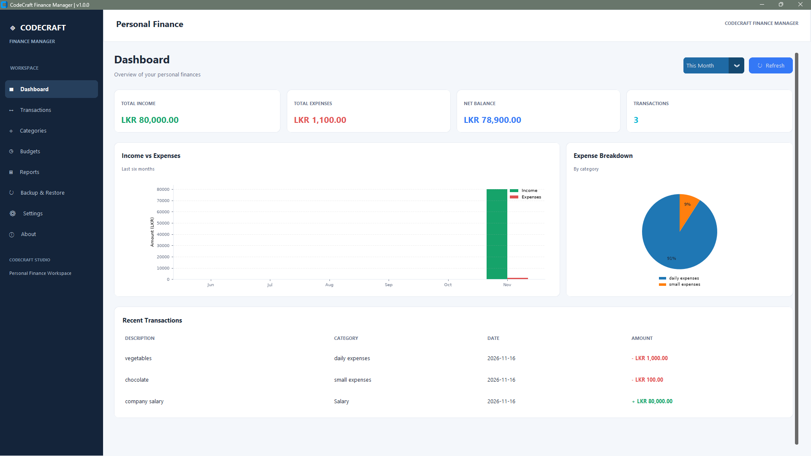
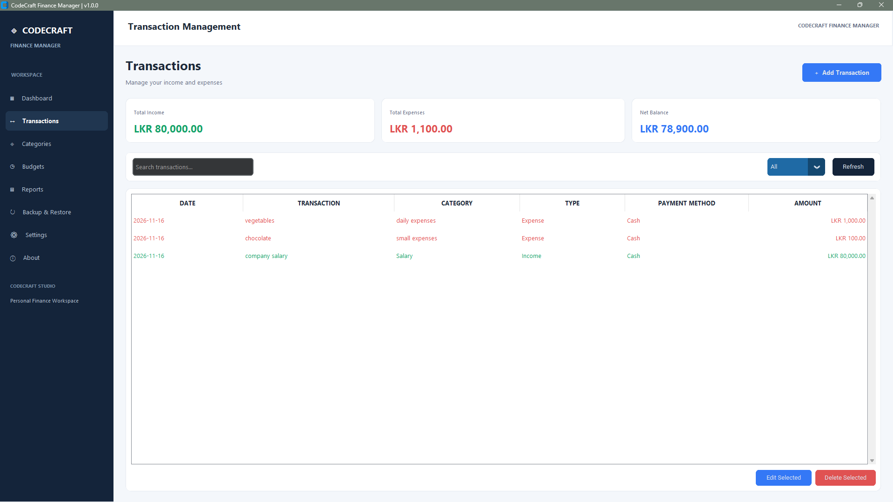
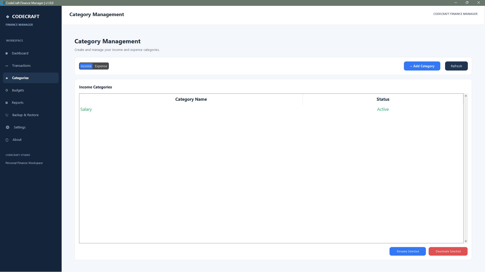
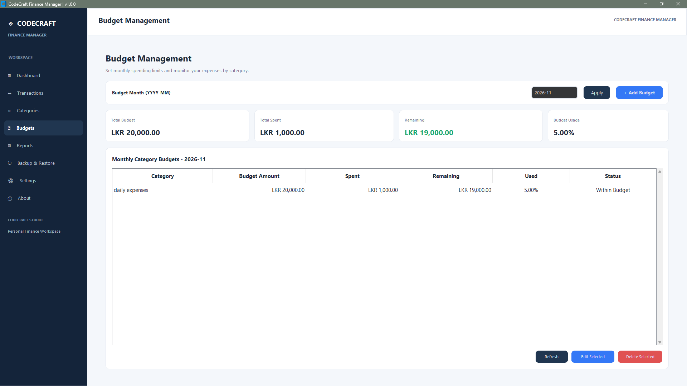
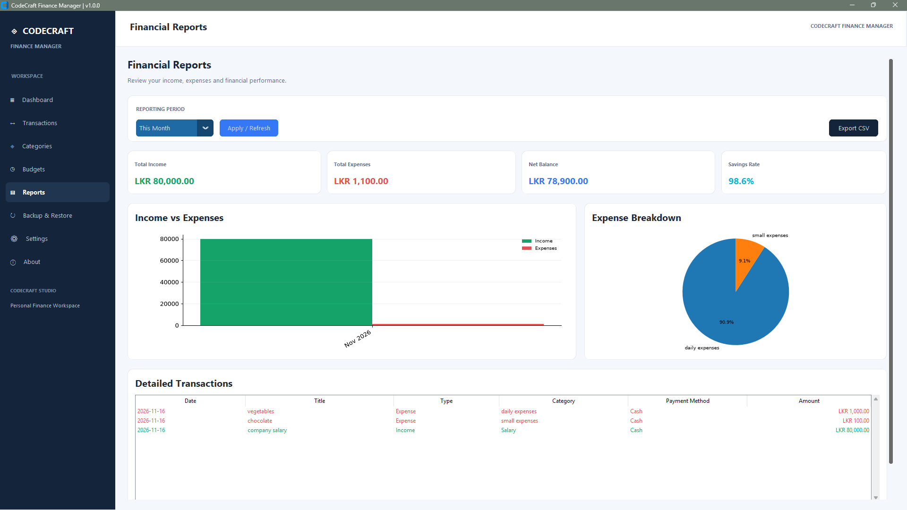
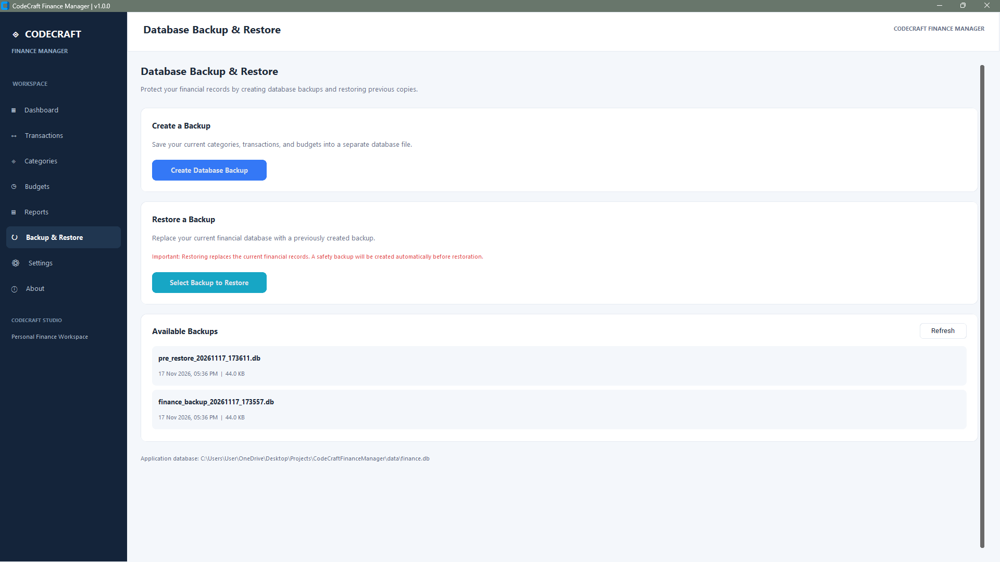
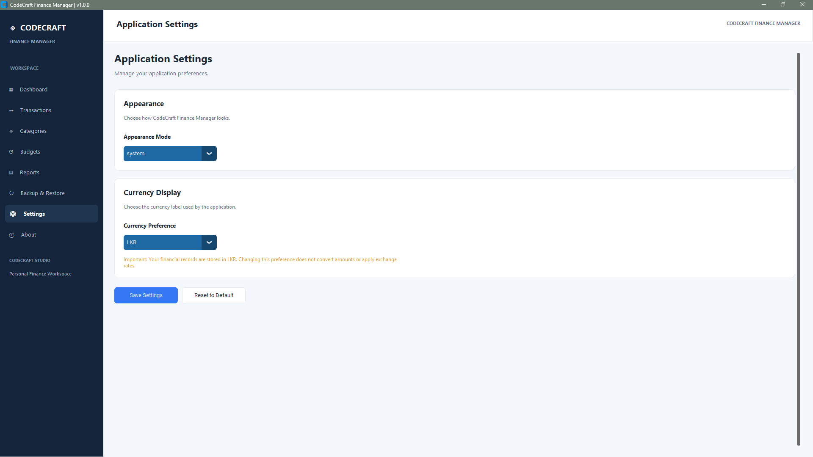
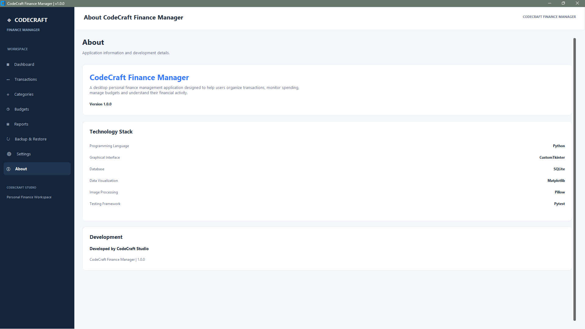

# CodeCraft Finance Manager

A desktop personal finance management application built with Python. CodeCraft Finance Manager helps users track income and expenses, manage budgets, monitor financial activity, and generate reports through a modern Windows interface.

## Overview

CodeCraft Finance Manager is designed to make personal financial management simple and organized. It uses a local SQLite database to store financial records and provides tools for tracking transactions, managing categories, setting monthly budgets, and reviewing financial reports.

## Features

- **Dashboard** – View financial summaries, charts, recent transactions, and monthly trends.
- **Transaction Management** – Add, edit, delete, search, and filter income and expense transactions.
- **Category Management** – Create, rename, and deactivate income and expense categories.
- **Budget Management** – Set monthly expense budgets and monitor spending.
- **Financial Reports** – Review financial performance across different date ranges.
- **CSV Export** – Export financial report data.
- **Backup and Restore** – Create database backups and safely restore financial data.
- **Application Settings** – Customize appearance and currency display preferences.
- **Local Data Storage** – Store financial records locally using SQLite.

## Application Screenshots

### Dashboard


### Transaction Management


### Category Management


### Budget Management


### Financial Reports


### Backup and Restore


### Application Settings


### About


## Technology Stack

| Technology | Purpose |
|---|---|
| Python 3.14 | Main programming language |
| CustomTkinter 6.0.0 | Desktop graphical user interface |
| SQLite | Local database |
| Matplotlib 3.11.2 | Financial charts and visualizations |
| Pillow 13.0.0 | Image processing |
| Pytest 9.2.0 | Automated testing |
| PyInstaller 6.22.3 | Windows executable packaging |

## Requirements

- Windows 10 or Windows 11
- Python 3.14
- Git (for cloning the repository)

## Installation

### 1. Clone the repository

```bash
git clone https://github.com/shazinnausar-spec/CodeCraftFinanceManager.git
```

### 2. Open the project directory

```bash
cd CodeCraftFinanceManager
```

### 3. Create a virtual environment

```bash
python -m venv .venv
```

### 4. Activate the virtual environment

PowerShell:

```powershell
.\.venv\Scripts\Activate.ps1
```

### 5. Install dependencies

```bash
pip install -r requirements.txt
```

### 6. Run the application

```bash
python main.py
```

## Build the Windows Executable

Install the development dependencies:

```bash
pip install -r requirements-dev.txt
```

Build a standalone Windows executable:

```bash
pyinstaller --noconfirm --clean --windowed --onefile --name "CodeCraft Finance Manager" --collect-all customtkinter --collect-all matplotlib main.py
```

After a successful build, the executable will be available at:

```text
dist/CodeCraft Finance Manager.exe
```

## Running Tests

Run the automated test suite:

```bash
python -m pytest -v
```

The project currently includes **96 automated tests**, covering database operations, services, transactions, budgets, reports, settings, dashboard functionality, and backup and restore operations.

## Data Storage

The application uses SQLite for local financial data storage.

When running from Python, application data is stored inside the project's `data` directory.

When running the packaged Windows executable, application data is stored in:

```text
%LOCALAPPDATA%\CodeCraftStudio\CodeCraftFinanceManager
```

Database backups are stored in the application's `backups` directory.

## Currency

The application uses LKR as its underlying currency.

Users can choose between two display formats:

- `LKR` – Example: LKR 1,500.50
- `Rs.` – Example: Rs. 1,500.50

Changing the display format does not convert or modify stored financial amounts.

## Project Structure

```text
CodeCraftFinanceManager/
│
├── app/
│   ├── database/
│   ├── services/
│   ├── ui/
│   └── utils/
│
├── screenshots/
├── tests/
│
├── config.py
├── main.py
├── requirements.txt
├── requirements-dev.txt
├── README.md
└── .gitignore
```

## Developer

**Developed by Shazin Nausar**

- GitHub: https://github.com/shazinnausar-spec
- LinkedIn: https://linkedin.com/in/mohammed-shazin-nausar

## License

This project is currently shared as a portfolio project. No formal open-source license has been added.
